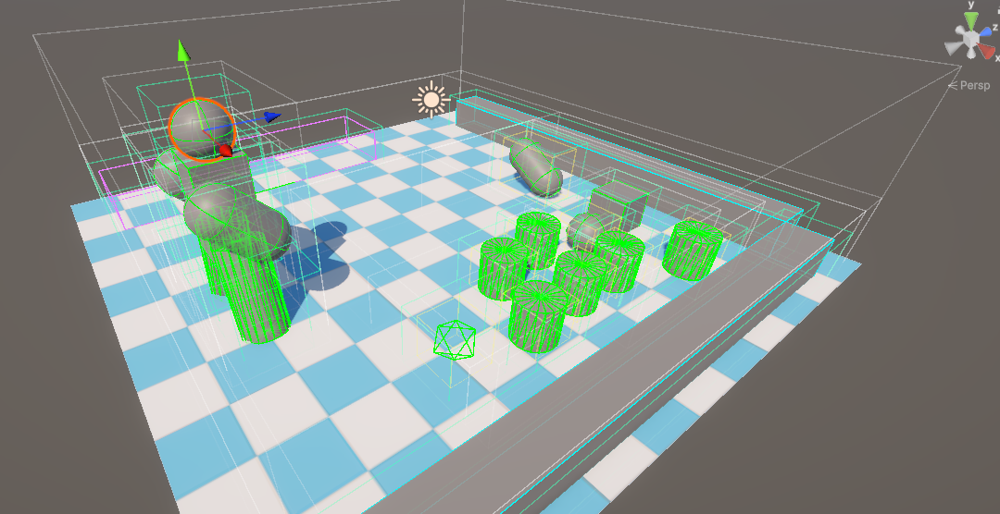

# FixedPhysics

Q32.32 Fixed-Point 3D Physics Engine for Unity

基于 Q32.32 定点数的 3D 物理碰撞检测框架
前六层为纯 C# 实现 不依赖UnityEngine负责底层的数学运算与碰撞求解
第七层为 Unity 表现层桥接 只负责同步位置与绘制 Gizmos 辅助线

## 架构设计
整个项目按职责从下往上分为七层：

### 第一层：定点数与空间基础 (FixedMath / Core)
- FP：基于 64 位 long 实现的 Q32.32 定点数，包含基础四则运算、128 位防溢出开方、快速幂、对数，以及用 CORDIC 算法实现的三角函数。
- FPVector2 / FPVector3 / FPQuaternion：定点数向量与四元数。向量模长使用 128 位中间精度计算，避免大坐标下直接平方溢出。
- FPTransform：记录位置与旋转，提供局部坐标与世界坐标的相互转换。
- FPBounds：轴对齐包围盒 (AABB)，提供相交检测、包含检测、表面积计算与盒子合并。

### 第二层：几何形状层 (Shape)
所有形状继承自 FPShape，只保存几何尺寸，不保存世界坐标，对外提供计算包围盒的 ComputeBounds 与获取支撑点的 GetSupportPoint 方法：
- FPSphere：球体
- FPBox：长方体 (支持旋转 OBB)
- FPCapsule：胶囊体
- FPConvex：自定义凸多面体，支持传入点云数组或直接提取 Unity Mesh 顶点

### 第三层：物理实体层 (Core)
- FPState：代表一个物体的唯一物理状态，保存物体的世界坐标 Transform、是否静态 IsStatic，以及 X/Y/Z 轴的位移锁定开关。
- FPCollider：具体的碰撞盒组件，持有一个形状 Shape 和局部偏移 Offset。同一个物体下可以挂载多个 FPCollider，它们共享同一个 FPState 坐标中心。

### 第四层：窄相碰撞检测 (Collider)
- CollisionManifold：记录窄相检测结果，包括是否碰撞、穿透深度和推挤法线。
- PhysicsMath：针对高频基础形状实现的解析解检测，包含 Sphere与Sphere、Sphere与Box、Box与Box (15轴SAT)，以及对应的精确射线求交。
- GJKEPA：通用凸多面体碰撞算法。用 GJK 判断是否相交，相交后用 EPA (基于小根堆与轮廓边缓冲区) 计算穿透深度与法线；同时实现了基于单纯形推进的通用凸体射线检测。

### 第五层：粗相空间划分 (BroadPhase)
定义统一的 IBroadPhase 接口，输出去重后的潜在碰撞对 ColliderPair，内部实现了三种空间划分结构，可在运行时随时切换：
- SpatialHash (空间哈希)：将空间划分为均匀网格，使用链式前向星一维数组建图，配合脏桶记录栈实现快速清空，射线查询采用 3D DDA 步进算法。
- Octree (八叉树)：使用一维数组连续分配 8 个子节点，压在分界线上的物体留在父节点，每个物体在树中只占一条边，分裂时原地修改链表指针下发节点。
- BVH (动态层次包围盒树)：利用外扩的肥包围盒 (Fat AABB) 实现增量更新，未跑出肥盒子的微小移动不修改树结构；插入节点时按表面积增量最小原则 (SAH) 寻路，通过回收栈复用废弃节点。

### 第六层：物理世界与求解器 (PhysicsWorld)
- 碰撞体管理：负责碰撞体的添加、移除与去重，过滤静态物体之间以及同一物体内部多碰撞盒之间的自碰撞。
- 位置求解器：每帧驱动粗筛与窄相检测，支持多轮迭代推挤以处理墙角多物体挤压，触发器只记录碰撞不产生物理推挤。
- 事件分发：使用双集合对比上一帧与当前帧的碰撞结果，按确定性顺序触发 OnCollisionEnter、OnCollisionStay、OnCollisionExit 回调。
- 空间查询：提供 QueryRay (按距离从小到大返回命中的碰撞体、距离、交点与法线) 和 QueryAABB (粗筛加窄相精测) 两个查询接口。

### 第七层：Unity 桥接与测试 (UNITY)
- FPConvert：负责初始化时将 Inspector 参数转为定点数，以及每帧将定点数位置单向同步回 Unity Transform。
- FPBody 与 ColliderComponentBase：挂载在 Unity 物体上的脚本，派生出球、盒、胶囊、凸包四个组件，并在 Scene 窗口绘制碰撞线框。
- FPRunner：全局物理步进驱动器，可在面板切换 SpatialHash / Octree / BVH 并绘制对应的空间结构线框。
- Player：测试控制脚本，用于验证移動碰撞、旋转碰撞、射线检测与范围查询。

## 运行与测试

1. 使用 Unity 打开工程，加载 Assets/Scenes/SampleScene.unity 场景。
2. 点击 Play 运行，在 Scene 窗口开启 Gizmos 即可看到碰撞盒与空间划分结构的线框：
   - W / A / S / D：控制角色前后左右移动，测试碰撞推挤与贴墙滑动。
   - Q / E：控制角色左右旋转。
   - 鼠标左键 / 空格：向前发射射线，测试 QueryRay 命中点、表面法线与击退效果。
   - 鼠标右键 / F键：以角色为中心执行 QueryAABB 范围检测并推开周围物体。
   - 在 Runner 物体面板上可以实时切换三种粗相空间划分算法。