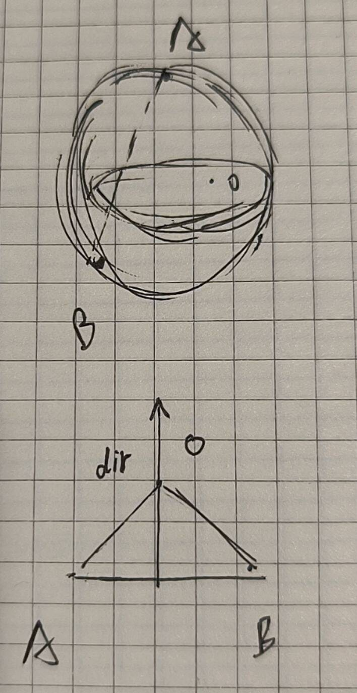

# 第四层:窄相精确碰撞与射线数学层设计笔记

本层位于 `FixedPhysics/Collider` 目录下, 包含碰撞结果结构 `CollisionManifold`、射线命中结构 `RayHit`、高频解析解算法库 `PhysicsMath`, 以及通用凸多面体算法库 `GJKEPA` 

设计目标:接收第五层粗相筛出的候选碰撞对或射线, 基于真实几何形状计算出精确的碰撞状态 `IsHit`、穿透深度 `Penetration`、推挤法线 `Normal`(统一规定方向由物体 A 指向物体 B)以及射线命中距离 `Length` 

---

## 1. 为什么采用“专用解析解 + GJK/EPA 通用兜底”的双轨架构?

在窄相设计中, 我们没有把所有形状都丢给 GJK/EPA, 也没有为每一种形状组合都编写两两特判代码, 而是采用双轨制:
1. 为什么高频基础形状(Sphere、Box)要写专用解析解?
   - 球与球、球与盒可以通过几何最近点直接一步算出结果, 耗时仅为 GJK 迭代的几分之一 
   - 长方体与长方体(Box vs Box)由完全平行的平面与棱组成 当一个方盒平放在另一个大方盒表面时, GJK/EPA 在处理大面积平行共面贴合时容易出现单纯形退化或多次迭代；而 15 轴分离轴定理(SAT)只需固定检测 15 根轴, 一步到位且极其稳定 
2. 为什么胶囊体(Capsule)与自定义凸包(Convex)不写专用解析解?
   - 若每增加一种新形状都与现有形状两两编写解析解, 函数数量会呈 $O(N^2)$ 爆炸 
   - 更重要的是, 像 `Capsule vs Box`(三维旋转线段与旋转六面体求穿透)在几何上没有简短的解析公式, 手写分类讨论长达数百行；而胶囊体只有上下两个端点球心, 送入 GJK/EPA 中仅需 2 ~ 4 次迭代即可极速收敛 因此复杂形状统一交由 `GJKEPA` 计算

---

## 2. PhysicsMath:高频形状解析解

### 2.1 Sphere vs Sphere (无平方防溢出设计)
计算球心连线向量 `dir = posB - posA` 
在早期版本中曾使用 `SquareMagnitude(dir)` 与半径和的平方比较, 但在大世界坐标下直接平方极易触发 64 位定点数乘法溢出 
因此统一改为直接调用第一层 128 位高精度的 `distance = FPVector3.Magnitude(dir)`:
- 若 `distance > rA + rB`, 则未碰撞 
- 否则穿透深度为 `(rA + rB) - distance`, 推挤法线为 `dir / distance`(若球心完全重合则默认取 `Up`) 

### 2.2 Sphere vs Box (局部空间转化 + 最近面分离)
由于长方体 B 在世界空间中带有任意旋转(OBB), 直接在世界空间求球心到旋转盒的最近点非常繁琐 
代码中利用第一层的空间转化, 分三步完成(一进一出):
1. 世界转局部:调用 `center = transB.ToLocalPos(transA.Position)`, 将球心拉入长方体 B 的局部坐标系 在该局部空间下, 长方体中心固定在原点 `(0,0,0)` 且无任何旋转, 退化为标准正交范围 `[-Extents, +Extents]` 
2. 局部空间 Clamp 求最近点:直接对局部球心坐标做三轴截断 `point = Clamp(center, -Extents, +Extents)`, 得到盒子表面离球心最近的点 
3. 分支处理(球心在盒外 vs 球心已深入盒内):
   - 情况 A(球心在盒外,`distance = Magnitude(center - point) > 0`):若 `distance <= radius`, 则发生碰撞 局部法线为 `(center - point) / distance`, 通过 `-transB.ToWorldDir(...)` 转回世界空间(保持由球 A 指向盒 B) 
   - 情况 B(球心已穿入盒内,`distance == 0`):此时 `point == center`, 差向量为 `0`, 无法直接求法线 必须触发内部逃生逻辑:计算球心到盒子六个面的剩余距离 `xd = Extents.x - |center.x|`、`yd`、`zd`, 挑出距离最小的那一面作为最短逃生通道, 穿透深度为 `radius + min(xd, yd, zd)`, 法线取该面的朝外轴向并转回世界空间 

### 2.3 Box vs Box (15 轴 SAT 分离轴定理)
两个三维有向长方体相交判定, 只需测试 15 根潜在分离轴:
- 盒子 A 的 3 个局部面法线轴(`Right, Up, Forward`)
- 盒子 B 的 3 个局部面法线轴(`Right, Up, Forward`)
- A 的 3 根轴与 B 的 3 根轴两两叉乘构成的 9 根棱边垂直轴 `Cross(AxesA[i], AxesB[j])`(用于检测棱对棱碰撞) 

实现细节与避坑:
1. 平行轴过滤:当 A 与 B 的某两根轴近似平行时, 叉乘结果接近零向量, 必须先判断 `Magnitude(cross) <= PHY_TOLERANCE` 跳过, 否则归一化后会产生噪点轴导致误判 
2. 投影半径计算:对于每一根单位测试轴 `axis`, 盒子 A 在该轴上的投影半宽为 `rA = extA.x * |Dot(AxesA[0], axis)| + extA.y * |Dot(AxesA[1], axis)| + extA.z * |Dot(AxesA[2], axis)|` 
3. 重叠量比较:`overlap = (rA + rB) - |Dot(T, axis)|` 只要任意一根轴上 `overlap < 0`(相切 `overlap == 0` 视为接触), 立即判定分离退出；若 15 根轴全部重叠, 取 `overlap` 最小的那根轴作为推挤法线 `normal`, 并通过与中心连线 `T = posB - posA` 点乘确保 `normal` 方向由 A 指向 B 

---

## 3. GJKEPA:通用凸多面体碰撞与穿透解算

### 3.1 GJK 单纯形迭代原理
利用闵可夫斯基差 $A - B$ 的性质:两个凸体相交, 当且仅当它们的闵可夫斯基差多胞体包含坐标原点 $O(0,0,0)$ 
通过 `GetPoint(dir) = shapeA.GetSupportPoint(dir) - shapeB.GetSupportPoint(-dir)` 在差集表面摸出极点构建单纯形 `Simplex`(从 1 个点逐步扩展为线段 `Do2`、三角形 `Do3`、四面体 `Do4`):
- 若某一步摸出的新极点 `A` 连原点都没跨过(`Dot(A, dir) < 0`), 说明在该方向上存在分离面, 直接返回未碰撞 
- 若在 `Do4` 中判断原点位于四面体四个侧面的内侧, 说明单纯形成功包住原点, 移交 EPA 算法计算穿透深度 

### 3.2 边界避坑:0.001 米级小物体连续叉乘下溢问题
在早期版本中, `Do2` 采用双重叉乘 `Cross(Cross(AB, AO), AB)` 计算垂线方向, `Do3` 采用 `Cross(AB, AC)` 计算面法线 
当测试两个半尺寸仅为 `0.001` 的极小凸盒时, 边向量 `AB` 和 `AC` 的长度约为 `0.001` 连续叉乘三次相当于将 `0.001` 连乘三次($10^{-9}$), 再做点积时数值变为 $10^{-12}$, 小于 Q32.32 的最小精度单位 $2^{-32} \approx 2.3 \times 10^{-10}$, 直接被截断下溢为 `0`, 导致穿透深度算作 `0` 

修复与化简:
1. 在 `Do2 / Do3 / Do4` 及 `EPAFace` 构造中, 先对只用于判断方向的边向量执行 `ab = Normalize(B - A)`, 将边方向放大回单位长度 `1.0`, 彻底消除小尺寸连续乘法下溢 
2. 在 `Do2` 中直接用向量投影减法 `direction = AO - ab * Dot(AO, ab)` 代替双重叉乘 `Cross(Cross(AB, AO), AB)`, 方向完全等价, 少算 12 次乘法, 且算出的 `direction` 模长直接等于原点到线段 `AB` 的垂直距离 

### 3.3 EPA (扩展多面体算法) 与小根堆破壁重构
当 GJK 确认相交并给出一个包含原点的初始四面体后, EPA 的目标是找到差集多胞体表面离原点最近的面(即最短推开距离与法线):
1. 将初始四面体的 4 个三角面放入按距离排序的小根堆 `FaceHeap` 中 
2. 每次弹出离原点最近的面 `face`, 沿着它的外法线 `face.Normal` 摸出极点 `point` 
3. 若极点到原点的投影距离与当前面距离之差小于容差 `PHY_TOLERANCE`, 说明已经触达多胞体真实外表面, 当前面的 `Distance` 和 `Normal` 即为最终穿透深度与法线 
4. 破壁与缝合:若还能往外扩张, 则遍历堆中所有面, 将所有“能看见新极点 `point`”的面(`Dot(item.Normal, point - item.A) > 0`)全部删除, 并把被删面的三条边加入轮廓边缓冲区 `EdgeBuffer` 
   `EdgeBuffer` 的妙用:当添加一条边时, 若发现缓冲区内已存在相同的共享边(两个相邻被删面共享的内部边), 则直接用末尾元素覆盖将其抵消删除 遍历结束后, `EdgeBuffer` 中留下的就纯粹是破洞边缘的轮廓线 将每条轮廓边与新极点 `point` 连接成新三角面压回小根堆, 继续下一轮迭代 

### 3.4 关键修复:FaceHeap 倒序删除时的上浮漏检陷阱与动态扩容
在 EPA 倒序遍历删除可见面 `for (int i = FHeap.Count - 1; i >= 0; i--)` 时, 早期代码在删除下标 `i` 时直接调用了完整的堆删除(拿末尾元素补到 `i`, 并立即执行 `UP(i)` 上浮或 `Down(i)` 下沉) 

漏检原因推演:
假设堆数组为 `[1, 4, 2, 5, 6, 3]`, 其中下标 `1`(值为 4)是下标 `4`(值为 6)的父节点, 且 4 和 6 都是需要删除的可见面 
1. 倒序循环走到 `i = 4`(值为 6, 需要删):将末尾 `Heap[5]`(值为 3, 不删的好面)移到下标 `4` 
2. 若此时立即触发 `UP(4)`:因为新换过来的 `3` 比父节点下标 `1` 的 `4` 小, `UP` 操作会将 `3` 和 `4` 交换！导致原本在下标 `1` 等待被检查删除的坏面 `4`, 被换到了下标 `4` 
3. 随后循环继续执行 `i--` 检查 `3, 2, 1, 0`, 被换到下标 `4` 的坏面逃过了检查残留下来, 导致多面体内部出现错误隔断 

修复方案:
将遍历删除拆分为两步:在 `for` 循环内部仅调用 `RemoveAt(i)`(`Heap[i] = Heap[--Count]`, 只拿末尾已检查过的元素补洞, 绝不调整堆顺序)；待 `for` 循环把所有可见面全部删干净后, 在循环外统一调用一次 `FHeap.Rebuild()` 自底向上 $O(N)$ 重新整理小根堆 同时在 `Push` 与 `AddEdge` 中加入 `Array.Resize` 翻倍扩容保护, 防止复杂凸包深度穿透时面数超出初始容量而丢面 

---

## 4. 精确射线检测算法 (Raycast)

### 4.1 射线与球体 (无平方几何解法)
为了避免二次方程判别式中的平方溢出, 全部采用几何投影与平方差公式求解:
1. 连结起点到球心的向量 `s = center - origin` 若 `Magnitude(s) <= radius`, 说明起点在球内, 直接命中(`length = 0, normal = -dir`) 
2. 计算球心在射线方向上的投影长度 `d = Dot(s, dir)` 若 `d <= 0`, 说明球在射线背后, 未命中 
3. 计算球心到射线的垂直向量 `perp = s - dir * d` 及垂线长度 `h = Magnitude(perp)` 若 `h > radius`, 说明擦肩而过未命中 
4. 利用平方差公式计算球内半弦长 `offset = Sqrt((radius - h) * (radius + h))`, 命中距离即为 `length = d - offset`, 球面法线为 `(hitPoint - center) / radius` 

### 4.2 射线与旋转盒 OBB (局部空间 Slab 切片法)
同样利用空间折跃:先保留世界空间下的单位射线方向 `worldDir`, 再将射线起点和方向通过 `ToLocalPos` 与 `ToLocalDir` 转入盒子的局部空间 
在局部空间中依次对 X、Y、Z 三对平行墙面 `[-ext, +ext]` 计算进入时间 `l` 与离开时间 `r`, 维护最大进入时间 `tMin` 与最小离开时间 `tMax`, 同时记录最晚进入的那个墙面的局部朝外法线 `localNormal` 

两个关键边界细节:
1. 微小斜率防误杀:判断射线是否平行于某轴时, 严格判断 `d == FP.Zero`, 而不能写 `|d| < PHY_TOLERANCE` 否则当射线斜率极小(如 `d.x = 1/32768 < 0.0001`)但射程较长时, 会错误地将 X 轴当成完全不动而漏判原本能走进盒子的射线；同时除法使用 `SafeDiv` 捕获极小分母溢出并饱和为 `MaxValue` 
2. 盒内起点法线方向:若 `tMin > 0`(起点在盒外), 将 `localNormal` 通过 `trans.ToWorldDir` 转回世界空间；若 `tMin == 0`(起点本就在盒子内部), 直接返回世界空间的 `-worldDir`(切勿返回局部空间的 `-localDir`, 否则盒子旋转后法线方向会随局部坐标系偏转) 

### 4.3 射线与任意凸多面体 (GJK 射线推进算法与钝角修复)
对于胶囊体与任意凸包, 在 `GJKEPA.Raycast` 中实现了基于单纯形推进的 GJK Raycast 算法 

余下部分请详见docs/images 里面有一些推演图

按时间顺序的算法推演过程:
将射线上的当前测试点 `cur`(初始为 `origin`)视为移动的相对原点, 定义差集顶点 `A = cur - p`(其中 `p` 为多胞体沿 `-dir` 摸出的最靠近 `cur` 的极点) 
1. 跨步推进状态(`gap = Dot(A, -dir) > PHY_TOLERANCE`):
   说明当前点 `cur` 与多胞体极点 `p` 之间存在以 `-dir` 为外法线的分离切平面 
   计算射线迎向该切平面的速度 `vr = Dot(dir, direction)` 若 `vr <= 0` 说明射线平行或背离切平面, 直接返回未命中；否则计算安全推进步长 `delta = gap / vr`, 将射线点直接推进到切平面上:`length += delta; cur = origin + direction * length;`, 并记录当前切平面外法线 `nor = -dir` 
   为什么推进后必须清空单纯形 `simplex.Count = 0`?
   因为旧单纯形中的顶点是相对于推进前的旧 `cur` 位置记录的 一旦 `cur` 沿着斜向射线移动了 `shift`, 旧顶点相对于新 `cur` 的角度关系已被拽歪 清空旧点后, 仅将新位置下的极点 `A` 作为 1 号种子点重新压入单纯形, 即可保证后续原地攒点时的坐标参考系绝对纯粹 
2. 原地攒点状态(`gap <= PHY_TOLERANCE`):
   当 `cur` 推进到切平面后, 在原地连续迭代 2 ~ 3 轮(此时不发生推进, 单纯形不清空):从 1 个点(顶点)扩展到 2 个点(棱边 `Do2`)再到 3 个点(侧面三角形 `Do3`), 由 `Do3` 的叉乘自动找出正对着 `cur` 的真实多胞体侧面法线 `dir`, 随后在下一轮触发最后一次推进直达多胞体表面 
3. 贴面收敛状态:
   当 `Do2 / Do3` 算出的原点到单纯形最近距离向量模长 `Magnitude(dir) <= PHY_TOLERANCE`(或 `NextSimplex` 返回 `true` 包含原点)时, 说明射线点 `cur` 已严丝合缝贴在多胞体表面上, 返回累计距离 `length` 与切平面法线 `nor` 

为什么在 Raycast 复用 Do2 / Do3 时必须补上钝角特判?
在普通的静态 GJK 碰撞检测中, 只有当新点跨过了固定原点(`Dot(A, dir) >= 0`)才允许进入 `Do2`, 因此原点必然夹在新点 A 与旧点 B 中间, $\angle OAB$ 永远是锐角 
但在 `Raycast` 中, 当 `Do3`(三角形)发现原点在某条边外侧退化回 2 个点, 或在容差带内直接压入新点时, 原点完全可能位于线段 `AB` 的端点 A 外侧(形成钝角 $\angle OAB > 90^\circ$, 即 `Dot(ab, AO) <= 0`) 
此时线段 `AB` 上离原点最近的点根本不是垂足, 而是端点 A 本身 若不做钝角判断而直接按垂线公式计算, 得出的搜索方向 `dir` 会偏转 90 度变成与射线垂直, 导致下一轮算出推进速度 `vr <= 0` 而提前误判退出 
因此在 `Do2` 开头加入 `if (Dot(ab, AO) <= 0) { simplex.Set(A); direction = AO; return false; }`, 并在 `Do3` 退化为边时直接转调 `Do2`, 即可用短短几行代码彻底解决所有斜射胶囊体与凸包的漏判问题 并且复用了代码 简洁性和可读性方面得到极大提升